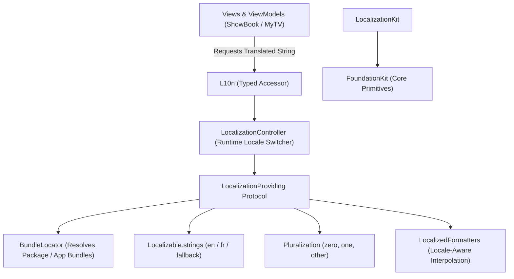

# LocalizationKit

Strongly-typed, locale-aware string resolution and dynamic runtime localization for iOS and macOS applications. Built on top of `FoundationKit`.


---

## Architecture



`LocalizationKit` decouples string catalog lookup from hardcoded strings and provides runtime flexibility:

1. **Strongly-Typed Key Safety**:
   - `L10n`: Centralized enum/namespace preventing typos and missing key crashes at runtime.
2. **Dynamic Runtime Locale Switching**:
   - `LocalizationController`: Allows users to switch the app's active locale (e.g. English, French, Spanish) on the fly without restarting the app or terminating the process.
3. **Multi-tier Fallback Strategy**:
   - Automatically resolves missing translations by falling back to the base language (English) and finally returning the raw key if no string file contains it.
4. **Bundle Agnostic**:
   - `BundleLocator` correctly locates resource bundles inside SwiftPM modules, nested frameworks, and main app bundles.
5. **Pluralization & Formatting**:
   - `Pluralization`: Implements deterministic plural rules (`zero`, `one`, `other`) for count-based strings.
   - `LocalizedFormatters`: Provides locale-aware argument interpolation.

---

## Use Cases

- **In-App Language Selection**: Empower users to choose their preferred app language inside application settings without altering the system-wide iOS language.
- **Type-Safe String Resolution**: Replace raw, fragile string literals (`NSLocalizedString("some_key", ...)`) with autocompleted, compiler-verified accessors.
- **Cross-Package Localization Sharing**: Share common localization resources (e.g., "Cancel", "Done", "Error", "Retry") across multiple modular packages.
- **Plural-Aware Text Rendering**: Render grammatically accurate text for dynamic numbers (e.g., "0 items", "1 item", "5 items").

---

## Practical Code Examples

### 1. Basic Typed String Resolution

```swift
import SwiftUI
import LocalizationKit

struct SettingsView: View {
    var body: some View {
        VStack(spacing: 12) {
            Text(L10n.string(forKey: "settings.title"))
                .font(.headline)
            Text(L10n.string(forKey: "settings.subtitle"))
                .foregroundColor(.secondary)
        }
    }
}
```

### 2. Runtime Language Switching

```swift
import LocalizationKit

let controller = LocalizationController.shared

// Switch application language to French dynamically
controller.setLocale(Locale(identifier: "fr"))

let welcomeMessage = controller.localizedString(forKey: "welcome.message")
print(welcomeMessage) // Outputs French translation

// Switch back to English
controller.setLocale(Locale(identifier: "en"))
```

### 3. Pluralization & Parameter Interpolation

```swift
import LocalizationKit

let count = 3
let pluralizedTemplate = Pluralization.pluralKey(for: "books.count", count: count)
// Resolves to "books.count.other"

let formattedString = LocalizedFormatters.format(
    template: L10n.string(forKey: pluralizedTemplate),
    arguments: [count]
)
// Result: "3 books found"
```

---

## Release Version Controlling

`LocalizationKit` adheres strictly to [Semantic Versioning (SemVer 2.0.0)](https://semver.org/spec/v2.0.0.html):

| Release Level | Criteria | Example Tag |
| :--- | :--- | :--- |
| **MAJOR** (`X.0.0`) | Breaking changes to localization provider APIs | `v1.0.0` |
| **MINOR** (`0.X.0`) | New locale support, additional formatters, enhanced pluralization | `v0.2.0` |
| **PATCH** (`0.1.X`) | Translation bug fixes, strings corrections, bundle resolution fixes | `v0.1.1` |

- **Changelog**: All release changes are tracked in [CHANGELOG.md](CHANGELOG.md).
- **Tag Standard**: Release tags are formatted as `vX.Y.Z` and validated via `bash Scripts/verify-release-version.sh`.
- **SPM Integration**:
  ```swift
  .package(url: "https://github.com/Anurag-Chourasia/LocalizationKit.git", from: "0.1.0")
  ```

---

## Quality & CI Verification

Every pull request and merge to `main` is gated by automated CI workflows:

1. **SwiftLint Gate**:
   - Enforces the organization's pinned 24-rule quality policy (`.swiftlint.yml`, SwiftLint 0.65.1).
   - Strict mode enabled (`--strict`, no warnings permitted).
   - Run locally: `bash Scripts/lint.sh`.
2. **Build and Test Gate**:
   - Pinned Xcode 27.0 toolchain with complete strict concurrency (`-strict-concurrency=complete`) and `-warnings-as-errors`.
   - Comprehensive test suite validating bundle location, locale fallbacks, pluralization, and string interpolation.
   - iOS Simulator product verification via `xcodebuild`.
