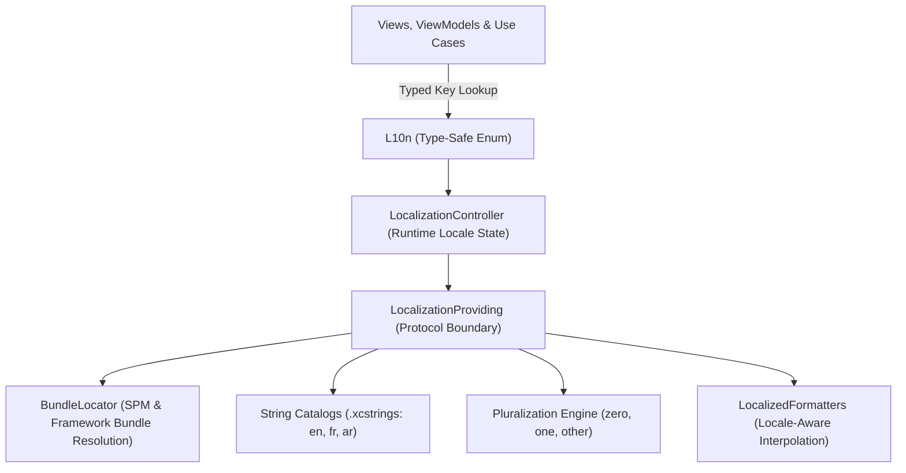
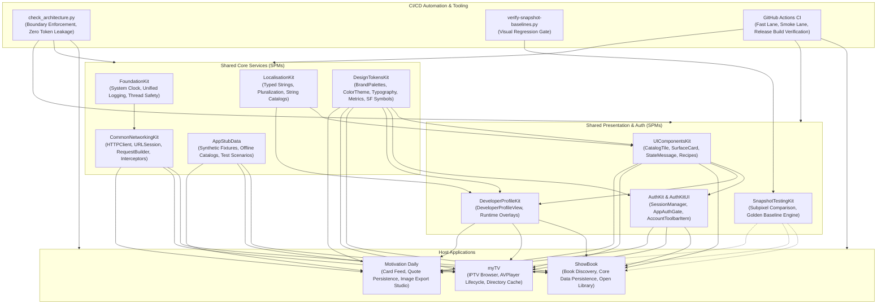

# LocalizationKit

Strongly typed, locale-aware string resolution, dynamic runtime language switching, and String Catalog (.xcstrings) integration for multi-app Swift ecosystems.


-success)


---

## 1. Executive Summary & Purpose

`LocalizationKit` provides compile-time string safety, multi-language localization, and runtime language selection without requiring an application process restart. It acts as the centralized copy engine across **ShowBook**, **myTV**, and **Motivation Daily**.

### Key Engineering Objectives:
- **Compile-Time Key Safety**: `L10n` accessors eliminate fragile string literals (`NSLocalizedString("...", ...)`), turning missing translation keys into compiler errors.
- **Dynamic In-App Language Switching**: `LocalizationController` allows users to toggle languages (English, French, Arabic) within the app settings, updating all active SwiftUI views instantly.
- **Pure Domain & Zero Visual Coupling**: Pure Swift and Foundation implementation; contains zero UI imports (`UIKit` / `SwiftUI`), allowing it to be safely consumed inside domain layers and use cases.
- **Pluralization & Semantic Error Copy**: Full support for plural rules (`zero`, `one`, `other`), localized network error recovery suggestions, and RTL (Right-to-Left) script direction.

---

## 2. Architecture & Design Principles



### Architectural Tenets:
1. **Zero External Dependencies (IOS-68)**: Operates strictly on Apple's `Foundation`. Does not couple to external networking, storage, or UI libraries.
2. **Deterministic Fallback Hierarchy**: Resolves translations through active user locale -> base language (English) -> raw key string fallback, preventing unrendered text or application crashes.
3. **Bundle Independence**: Automatically resolves whether resources live inside the main application bundle, a test bundle, or an embedded Swift Package resource bundle.

---

## 3. Dependency Graph & Consumer Matrix

| Direction | Package / Project | Responsibility |
|---|---|---|
| **Upstream Dependencies** | *None* | Zero third-party or internal dependencies. Pure Apple `Foundation`. |
| **Downstream Consumers** | **UIComponentsKit** | Reusable controls (menus, banners, buttons) consume common action labels. |
| | **AuthKit & AuthKitUI** | Authentication notices, password requirements, and session error alerts. |
| | **DeveloperProfileKit** | Biography headers, social link labels, and version disclaimer strings. |
| | **ShowBook** | Book search prompts, catalog filters, reading lists, and Core Data error copy. |
| | **myTV** | Channel directory categories, stream status alerts, and player controls. |
| | **Motivation Daily** | Category titles, share studio actions, and favorite quote persistence alerts. |

---

## 4. API Contracts & Practical Code Examples

### 1. Type-Safe Localized String Resolution
```swift
import SwiftUI
import LocalizationKit

struct ErrorBannerView: View {
    let error: LocalizedError

    var body: some View {
        VStack(alignment: .leading, spacing: 4) {
            Text(L10n.Common.errorTitle.localized)
                .font(.headline)
            Text(error.localizedDescription)
                .font(.subheadline)
            Text(L10n.Common.retryAction.localized)
                .font(.caption)
        }
    }
}
```

### 2. Plural-Aware Count Formatting
```swift
import LocalizationKit

// Automatically formats grammatically correct strings:
// "0 books found", "1 book found", "42 books found"
let message = L10n.Catalog.booksCount(42).localized
```

### 3. Dynamic Runtime Language Switching
```swift
import SwiftUI
import LocalizationKit

struct LanguagePickerView: View {
    @ObservedObject var controller = LocalizationController.shared

    var body: some View {
        Picker("Language", selection: $controller.currentLocale) {
            Text("English").tag(Locale(identifier: "en"))
            Text("Français").tag(Locale(identifier: "fr"))
            Text("العربية").tag(Locale(identifier: "ar"))
        }
        .pickerStyle(.segmented)
    }
}
```

---

## 5. Verification & Testing

```sh
# Run string catalog resolution, pluralization, and RTL tests
swift test

# Validate that no UI frameworks are imported in LocalizationKit
python3 /path/to/UIComponentsKit/Scripts/check_architecture.py --workspace-root /path/to/Projects
```

---

## 6. End-to-End Ecosystem Connectivity



---

## 7. Canonical Notion Dashboards & Governance Links

- [iOS Portfolio — Engineering Tickets Dashboard](https://app.notion.com/p/c20d7f4b133b44499c8ac0b4d5f6249e?pvs=204)
- [iOS Portfolio — Master Document](https://app.notion.com/p/40ffa5f855b98192ad2ede66a5d36fe7)
- [Architecture Boundary Validator (`check_architecture.py`)](file:///Users/anuragchourasia/Desktop/Projects/UIComponentsKit/Scripts/check_architecture.py)
- [Release & Gate Policy Documentation (`Docs/MASTER.md`)](file:///Users/anuragchourasia/Desktop/Projects/Docs/MASTER.md)
